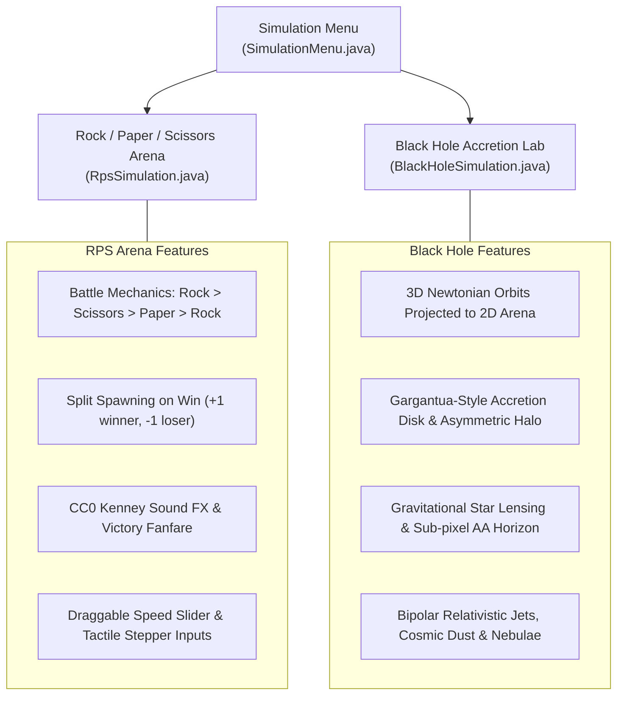

# ZoeSim 🪐✨

[](https://openjdk.org/)
[](https://libgdx.com/)
[](https://maven.apache.org/)
[](LICENSE)

A desktop physics and arcade simulation lab built with pure Java and [libGDX](https://libgdx.com/). Features a real-time **Rock, Paper, Scissors Battle Arena** and an animated **Black Hole Accretion Simulation**.

> 💜 **A Father & Daughter Project**  
> ZoeSim is a personal project that my daughter Zoe and I "vibe coded" together for fun, creative play, and learning. We're sharing the code openly for anyone who enjoys physics simulations, game experiments, or wants to explore how it was built.  
>  
> **Please note:** Because this is a personal family project, **we are not seeking or accepting pull requests, issues, or outside contributions**. You are very welcome to fork this repository and make it your own!

---

## What's Inside



---

## Simulation Modes

### 1. Rock / Paper / Scissors Battle Arena 🪨📄✂️

A high-energy, real-time battle royal between rocks, papers, and scissors inside a circular containment ring:

- **Battle Mechanics**:
  - Rock smashes Scissors.
  - Paper wraps Rock.
  - Scissors cut Paper.
- **Split Multiplication**: When a winning piece collides with a losing piece, the loser vanishes and the winner splits into two pieces of its own type (net count: +1 winner, -1 loser).
- **Procedural Sprites**: Rendered with custom procedurally-generated graphics — textured irregular stones, folded notebook paper, and scissors with animated cutting blades.
- **Spark Physics**: Collisions trigger firework-like particle sparks driven by velocity and gravity.
- **Victory Celebration**: When a single faction conquers the arena, a celebration banner and fanfare audio announce the winner!
- **Interactive Controls**:
  - Adjust starting populations for Rock, Paper, and Scissors.
  - Stepper buttons support single clicks, hold-to-repeat, and direct numeric typing (press <kbd>Enter</kbd> to commit).
  - Draggable global simulation speed slider.
  - Pause, resume, and instant reset.

---

### 2. Black Hole Accretion Simulation 🕳️🌌

A visual exploration of gravitational capture and relativistic aesthetics inspired by astrophysically credible models (such as *Interstellar's* Gargantua):

- **3D Orbital Dynamics**: Influx celestial objects travel along Newtonian orbital trajectories in three dimensions, then project onto the circular arena. Inclined orbits sweep realistically in front of and behind the event horizon.
- **Diverse Celestial Population**: Continuous stream of varied celestial bodies — rocky asteroids, icy dwarf planets, ringed gas giants, comets with ion tails, and bright stars. Larger bodies possess greater mass (`mass ∝ radius²`).
- **Gargantua-Style Accretion Disk**: Bright, tilted, turbulent accretion disk with asymmetric top/bottom gravitational lensing arcs, luminous inner photon ring, and warm umber dust clouds.
- **Sub-Pixel Anti-Aliased Horizon**: Features an analytic cubic Hermite smoothstep transition band ($aaBand = 2.4\text{px}$) on a procedural 1024×1024 texture, preventing pixelation or stairstepping even at high resolutions.
- **Cosmic Effects**:
  - Background star field distortion via gravitational lensing.
  - False-color bipolar relativistic jets streaming from rotational poles.
  - Dynamic absorption flares and particle sparks as bodies cross the Schwarzschild boundary.
  - Atmospheric deep space ambient audio.

---

## Quick Start

### Prerequisites

- **Java Development Kit (JDK)**: Java 17 LTS or higher. Verify with:
  ```bash
  java -version
  ```
- **Apache Maven**: Maven 3.6+ installed. Verify with:
  ```bash
  mvn -version
  ```

### Running the Application

Launch the desktop simulation window directly using Maven:

```bash
mvn exec:java
```

### Building a Standalone Executable JAR

Build the shaded fat JAR (includes all libGDX native libraries for Linux, macOS, and Windows):

```bash
mvn package
```

Run the compiled JAR:

```bash
java -jar target/rps-arena.jar
```

### Running Tests & Headless Checks

Run all JUnit 4 automated tests:

```bash
mvn test
```

Run the headless model smoke checks (verifies simulation physics and math without opening an OpenGL window):

```bash
mvn exec:java -Dexec.args="--headless"
```

---

## Controls & Usage

| Control | Action |
|---|---|
| **Click Simulation** | Select a mode from the main launch menu |
| **Back / Menu** | Return to the simulation selection menu |
| **`+` / `-` Steppers** | Click or press-and-hold to adjust starting populations |
| **Numeric Value Click** | Click any number to type a custom value directly (press <kbd>Enter</kbd> to apply, <kbd>Esc</kbd> to cancel) |
| **Speed Slider** | Click and drag to smoothly speed up or slow down time |
| **Pause / Resume** | Freeze the simulation clock or resume real-time physics |
| **Reset** | Clear the arena and restart with current parameters |

---

## Project Structure

```
zoesim/
├── pom.xml                       # Maven build file (libGDX 1.13.5, LWJGL 3, Maven Shade)
├── README.md                     # Project overview and instructions
├── SIMULATION_REQUIREMENTS.md    # Detailed functional specification & physics parameters
├── images/                       # Accretion disk and black hole visual reference assets
└── src/
    ├── main/
    │   ├── java/zoesim/
    │   │   ├── DesktopLauncher.java     # Application entry point & headless detector
    │   │   ├── SimArena.java            # libGDX ApplicationListener lifecycle
    │   │   ├── SimulationMenu.java      # Main simulation selection menu
    │   │   ├── CrispFont.java           # Anti-aliased high-DPI font generator
    │   │   ├── ArenaSimulation.java     # Base interface for simulations
    │   │   ├── RpsSimulation.java       # Rock-Paper-Scissors battle arena logic & rendering
    │   │   └── blackhole/               # Black hole subsystem
    │   │       ├── BlackHoleSimulation.java  # Coordinator facade
    │   │       ├── BlackHoleWorld.java       # Celestial body state & orbital lifecycle
    │   │       ├── BlackHolePhysics.java     # 3D gravity, drag, and event horizon math
    │   │       ├── BlackHoleRenderer.java    # Procedural disk, halo, jets, and star rendering
    │   │       ├── BlackHoleUI.java          # Controls and telemetry panel
    │   │       ├── BlackHoleAudio.java       # Ambient audio and absorption sounds
    │   │       ├── CosmicParticle.java       # Orbiting celestial object model
    │   │       └── JetParticle.java          # Relativistic jet particle model
    │   └── resources/sounds/            # CC0 audio clips (knocks, wraps, snips, victory fanfare)
    └── test/java/zoesim/                # JUnit headless test suite
```

---

## Audio Credits

The sound effects used in this simulation are licensed under **Creative Commons Zero (CC0)** by [Kenney](https://kenney.nl/):
- **Kenney Interface Sounds**: Button clicks, knocks, snips, and wrap effects.
- **Kenney Sci-Fi Sounds**: Deep space ambience, gravity absorption audio, and celebration fanfare.
- Full license files are included alongside the audio assets in `src/main/resources/sounds/`.

---

## License

This project is open-source software licensed under the [Apache License, Version 2.0](LICENSE).
